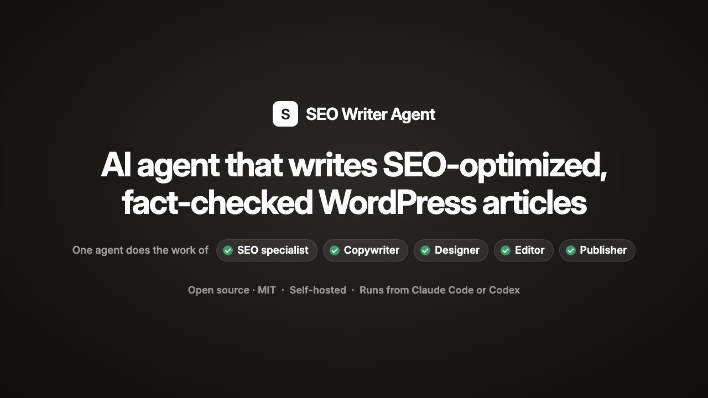
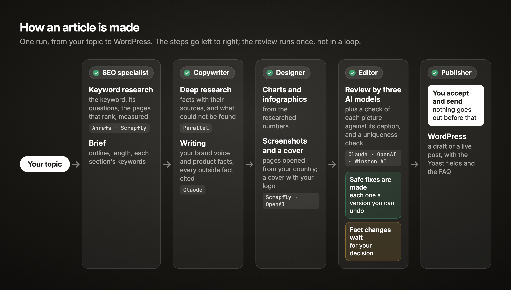
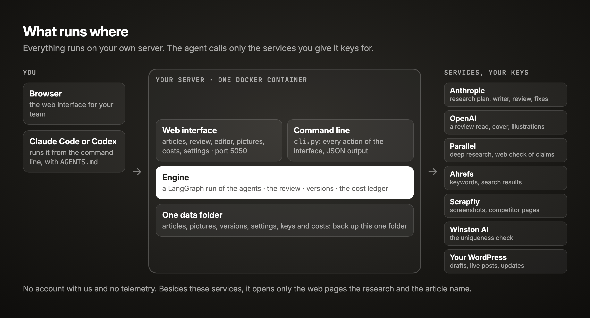
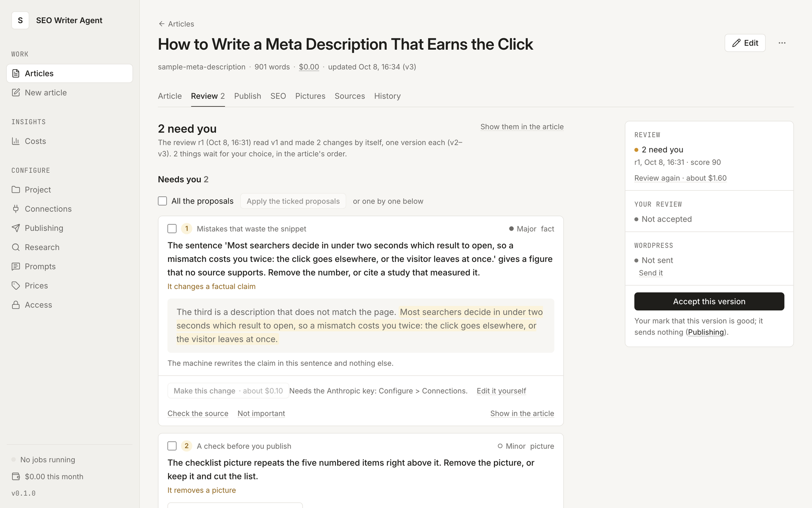

# SEO Writer Agent: an open-source AI agent that writes SEO-optimized, fact-checked WordPress articles

[](https://github.com/tymoshenko-dmytro/seo-writer-agent/releases)
[](LICENSE)
[](#quickstart)
[](AGENTS.md)

**[▶ Watch the 52-second video](https://github.com/tymoshenko-dmytro/seo-writer-agent/releases/tag/v1.0.0)**

*From a topic to a reviewed WordPress article in 52 seconds: the five roles, the review you
control, and how to run it. Sound on.*

One blog article usually needs five people: an SEO specialist, a copywriter, a designer, an editor
and someone to publish it. SEO Writer Agent does the work of all five. Give it a topic, and you get
an SEO-optimized article for your WordPress: researched, with a source for every fact, charts and
a cover, and reviewed by three AI models. Every change it makes can be undone, and the article goes
to WordPress only when you send it.

Built by [Dmytro Tymoshenko](https://www.linkedin.com/in/tymoshenko-dmytro), Head of Growth at
Palabra.ai, where it writes the company blog.

## Meet the team: five roles in one agent



| Role | What it does | Works with |
|---|---|---|
| **SEO specialist** | Picks the keyword from real search data, opens and measures the pages that rank, and plans the length and structure from them. Writes the meta title, description and FAQ for Yoast, adds internal links from your sitemap, and reports the keyword coverage | Ahrefs, Scrapfly |
| **Copywriter** | Gathers the facts and the page each one comes from, and writes in your brand voice. About your product it says only what your product facts say, and it follows your editorial rules | Parallel, Claude |
| **Designer** | Draws charts from the researched numbers, makes infographics and a cover with your logo, and takes screenshots of the products the article discusses, opened from your target country | OpenAI, Scrapfly |
| **Editor** | Three AI models from two vendors review the article, and each picture is checked against its caption. Safe fixes are made for you, each one a version you can undo; a change to a fact waits for your decision. A uniqueness check runs before you publish | Claude, OpenAI, Winston AI |
| **Publisher** | Sends the article to WordPress as a draft or a live post, with its Yoast fields, only when a person sends it | WordPress |

## How an article is made



A run takes from several minutes to over an hour, most of it in the deep research. You can run
the review again after your edits. The steps in detail: [`docs/architecture.md`](docs/architecture.md).

## What runs where



## Why use this AI writing tool

- **Facts you can check.** Each claim about a third party links to its source. If the research does
  not find a fact, the article does not state it.
- **You keep the final say.** The machine makes only the safe fixes. Facts, removed pictures and new
  sections wait for you, and WordPress gets the article only when you send it.
- **Your server, your keys, your data.** It runs in Docker on your machine. You pay the AI and data
  providers directly, and see the cost of each article, step and service before and after it runs.
- **Writes about your product, not a generic one.** At setup you give it your project's name, site,
  brand voice, product facts and editorial rules, and every article follows them. It suits any
  business: a software company, an agency, a marketplace.
- **Your coding agent can run it.** Every action in the web interface is also a command with JSON
  output, and [`AGENTS.md`](AGENTS.md) tells Claude Code or Codex how to install and operate it and
  which steps cost money.



## Quickstart

You need Docker, the keys of the seven services below, and a WordPress site with an application
password.

```bash
git clone https://github.com/tymoshenko-dmytro/seo-writer-agent.git
cd seo-writer-agent
cp .env.example .env          # set UI_PASSWORD; the keys can go here or into the setup screen
docker compose up --build
```

Open <http://localhost:5050>, sign in with `UI_PASSWORD`, and follow the setup: the project, its
texts, the keys (each is tested for free), WordPress. The sample article (*Open the sample
article*) shows what a finished article looks like before you spend anything. Then *New article*
and a topic.

The Studio listens on this machine only (`127.0.0.1:5050`). To share it with a team, put it
behind your own HTTPS proxy and set `UI_COOKIE_SECURE=1`.

**Or ask your agent to set it up.** Give Claude Code or Codex this repository and your keys;
[`AGENTS.md`](AGENTS.md) tells it how to install, configure, check and run the Studio from the
command line, and which steps cost money.

## The services

All seven are required: a run uses every one of them. The setup and `cli.py doctor` test each key
with a free call, and a run does not start until all of them pass.

| Service | What it does in a run | What you need |
|---|---|---|
| [Anthropic](https://console.anthropic.com) | research planning, the writer, the review, the fixer | an API key |
| [OpenAI](https://platform.openai.com) | the GPT read in the review, the cover and illustrations | an API key |
| [Parallel](https://platform.parallel.ai) | deep research with sources, the web check of claims | an API key |
| [Ahrefs](https://ahrefs.com/api) | keywords, search results, the competitors' pages | an MCP key; its calls spend your plan's API units |
| [Scrapfly](https://scrapfly.io) | screenshots and competitor pages opened from the article's country | an API key |
| [Winston AI](https://gowinston.ai) | the uniqueness check | an API key (2 credits a word) |
| WordPress | publishing: drafts, live posts, updates | a user who can publish, and an application password |

The Yoast meta tags and the FAQ field need a small addition on the WordPress side: see
[WordPress](docs/configuration.md#wordpress) in the configuration notes.

What each call sends: the topic, the research and the article's text go to the model providers;
search queries and URLs go to Parallel, Ahrefs and Scrapfly; the finished text goes to Winston AI;
the article and its pictures go to your WordPress.

## What an article costs

Every paid call is written to the article's cost ledger as it happens: model tokens (cache reads
and writes apart), Parallel runs and searches, image calls, Scrapfly credits, Ahrefs and Winston
units. The Studio adds them up against a price table you can edit (Configure > Prices): per
article, per part of its life (the generation, a review, a redraw), on the Costs page with a CSV,
and as `cli.py costs`. A paid action shows its estimate before it starts.

**Measured on 2026-10-09**, with the default models (Claude Opus 5.5 for the writer, the fixer
and the pictures; Claude Sonnet 5.5 for the research and the brief; a review panel of Opus 5.5,
Sonnet 5.5 and GPT-5.6-SOL) and Parallel's `pro` research: one article on "how to hire a
marketer", about 3,400 words with 12 pictures, written and reviewed once (14 changes made by the
machine), took 30 minutes. It cost $3.85 in model, research, image and screenshot calls, plus
10,743 Ahrefs API units and 7,008 Winston credits, which your plans pay for.

Before an install has run anything, the estimate shown before a run is $5 for an article and
$1.60 for a review again; after that it is the average of that install's own last runs. A run
takes from several minutes to over an hour, most of it in the deep research.

Prices change; the ones the Studio uses are dated in `core/pricing.py`. Ahrefs and Winston are
priced by your plan: enter what you pay per unit under Configure > Prices, or they are shown in
units.

## Limits

It is built for one trusted team on its own server, not as a service for strangers:

- one password for everyone who uses it, no accounts or roles;
- one process: the job queue lives in memory, so a restart stops the runs in progress (they can be
  run again from their saved research);
- the keys are kept on the data volume in a file only its owner can read, not encrypted;
- it fetches whatever pages the research and the article name, with no guard against addresses
  inside a private network: do not run it next to services that trust their network;
- the container runs as root, and Chromium with `--no-sandbox`.

## Without Docker

Python 3.14.

```bash
python3.14 -m venv .venv
.venv/bin/pip install -r requirements.txt
.venv/bin/playwright install chromium
cp .env.example .env
.venv/bin/python -m ui.app          # the Studio on http://127.0.0.1:5050
```

`cli.py` runs everything the interface does: `.venv/bin/python cli.py -h`.

## Where its data lives

Everything an install saves is in one folder: the Docker volume (`studio-data`, mounted at
`/app/project/output`), or `project/output/` (`CONTENT_OUTPUT_DIR`) without Docker. One folder
per article (its text, pictures, versions, review and cost ledger), and the install's settings,
keys, project texts, edited prompts and password. Back that folder up; the image holds none of it.

To update: `git pull && docker compose up --build -d`. The data folder carries over.

## Documentation

- [`docs/architecture.md`](docs/architecture.md): the steps of a run, the review, versions, where
  each part of the code lives.
- [`docs/configuration.md`](docs/configuration.md): the environment, the project, the settings,
  the prompts, the models and prices.
- [`docs/cli.md`](docs/cli.md): every command.
- [`AGENTS.md`](AGENTS.md): installing and running it through an agent.

## Tests

```bash
.venv/bin/pip install -r requirements-dev.txt
.venv/bin/python -m pytest
```

The tests use no key and reach no network. One of them runs a whole article, from the topic to
the review, on stand-in services (`tests/standin.py`). `python bin/docker_smoke.py` builds the
image and checks it the way a new user meets it.

## Licence

MIT, see [`LICENSE`](LICENSE). The bundled fonts and libraries keep their own licences
([`THIRD_PARTY_NOTICES.md`](THIRD_PARTY_NOTICES.md)).
