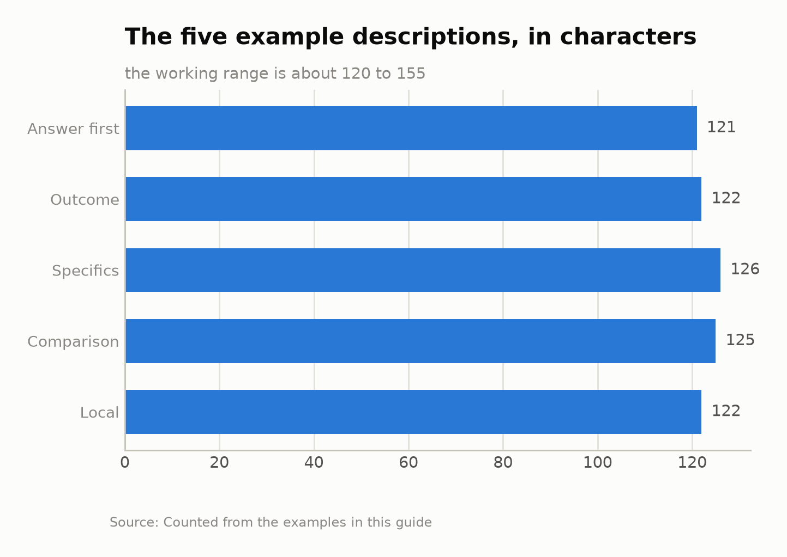
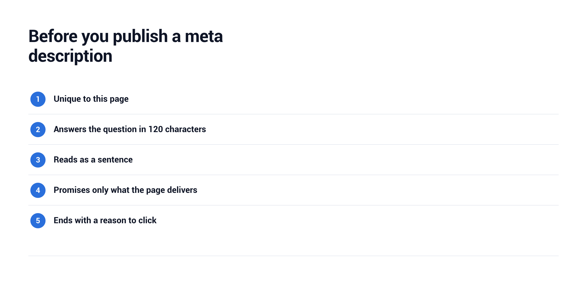

# How to Write a Meta Description That Earns the Click

A meta description is the short summary under a page's title in search results. Writing a good one takes ten minutes and pays back every time the page appears in a search, because it is the one line you control that tells a searcher why your page answers the question. This guide covers what the tag does, how long it should be, five patterns that work and the mistakes that waste it.

## What a meta description does

The meta description is an HTML tag in the head of a page: `<meta name="description" content="...">`. Readers never see it on the page itself. They see it in search results, where it often becomes the snippet under the title.

Often, not always. Google's documentation says it [sometimes uses the meta description](https://developers.google.com/search/docs/appearance/snippet) when the tag describes the page more accurately than text taken from the page. When it does not, Google builds the snippet from the page content instead, so a description that matches the page closely is the one most likely to be shown.

The tag is not a place to stuff keywords. Its job is to win the click once the page already ranks: the searcher has a question, and the description says your page answers it.

## How long a meta description should be

There is no fixed meta description length. The same documentation says there is no limit on how long a description can be, but the snippet is truncated as needed, typically to fit the device width. In practice the first part of the description carries the weight, and anything after it may be cut.

A sensible working range is about 120 to 155 characters. Shorter descriptions leave room unused; longer ones risk losing their ending on a phone. Put the most important words first, so a cut costs only the least important ones.

*The length of the five example descriptions in this guide, in characters*

The chart counts the five examples from the next section. All of them sit inside the working range, and none needs its last words to make sense.

## Patterns that make a description worth clicking

Most descriptions that earn clicks follow one of a few patterns. Pick the one that matches what the searcher wants from the page.

| Pattern | When it fits | Example |
|---|---|---|
| Answer first | A question with a short answer | "A meta description should run about 120 to 155 characters. Here is why, and how to write one that fits every screen size." |
| Outcome | A guide or tutorial | "Write meta descriptions that win clicks: five patterns, a length rule and a checklist you can use on your next page today." |
| Specifics | A product or pricing page | "Plans from $9 a month, unlimited projects and a free 14-day trial. Compare the features and pick the plan that fits your team." |
| Comparison | A roundup or versus page | "We compared six project tools on price, setup time and integrations, so you can choose one without reading six pricing pages." |
| Local | A page for one place | "Open seven days a week in central Leeds. Walk-in repairs for phones and laptops, most done while you wait. See our prices." |

The prices and places in the examples are made up for illustration: on a real page, use your own.

Each pattern makes one promise the page keeps. That is the real rule: a description that oversells gets the click and then loses the reader, who goes back to the results and picks someone else.

## Mistakes that waste the snippet

The most common mistake is the same description on many pages. Google notes that identical or similar descriptions on every page are not helpful when individual pages appear in search results. If a template fills in the same sentence everywhere, write page-specific descriptions for your most important pages first.

The second is a list of keywords instead of a sentence. Descriptions made of long strings of keywords do not give searchers a clear idea of the page's content, and they read as spam. Write for a person with a question.

The third is a description that does not match the page. Most searchers decide in under two seconds which result to open, so a mismatch costs you twice: the click goes elsewhere, or the visitor leaves at once.

Finally, avoid writing the description last, in a hurry, after the page is published. Google may rewrite the snippet anyway, but a careful description is what it shows when the page and the tag agree.

## A check before you publish

Before a page goes live, run through a short check. It takes a minute and catches most of the problems above.

1. The description is unique to this page.
2. It answers the searcher's question in the first 120 characters.
3. It reads as a sentence, not a list of keywords.
4. It promises only what the page delivers.
5. It ends with a reason to click: a number, a result or a next step.

If a page should never show a snippet, the nosnippet rule handles that, and max-snippet sets a maximum length. Both are described in the same Google guide.